# FuelIQ

### Raman Gasoline Octane Screening with a Built-In Trust Check

**A proposed field fuel-quality intelligence system combining Raman spectroscopy, machine learning, and an applicability-domain safeguard to help users decide when an octane estimate is useful—and when laboratory confirmation is needed.**

<p align="center">
  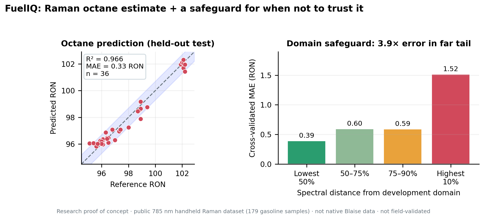
</p>

<p align="center">
  <a href="https://www.herox.com/xTechIdeaCompetition?from=home"><strong>Blaise xTech Competition</strong></a> ·
  <a href="https://youtube.com/watch?v=6xwVU_PyTNk"><strong>Watch the Pitch Video</strong></a> ·
  <a href="fueliq-revised.ipynb"><strong>Explore the Research Notebook</strong></a>
</p>

---

## The idea

Gasoline quality checks can require laboratory testing, sample handling, and turnaround time. A field instrument that produces a useful preliminary estimate could help fuel-quality personnel screen samples more efficiently—but only if users can also recognize when the model is operating outside its demonstrated experience.

**FuelIQ proposes to pair a Raman-based Research Octane Number (RON) estimate with a spectral applicability-domain check.**

The intended workflow is:

1. Acquire a gasoline Raman spectrum using a compatible handheld instrument.
2. Process the spectrum and estimate RON using a trained machine-learning model.
3. Assess how closely the spectrum resembles the model's development data.
4. Communicate the estimate and an appropriate screening status.
5. Recommend laboratory confirmation when the evidence is insufficient.

The current work establishes a promising research baseline on a public gasoline Raman dataset. Integration with Blaise hardware, validation on native Blaise spectra, and field testing remain future development milestones.

## At a glance

| Project element              | Current status                                                                        |
| ---------------------------- | ------------------------------------------------------------------------------------- |
| Application                  | Preliminary gasoline octane screening                                                 |
| Target measurement           | Research Octane Number (RON)                                                          |
| Spectroscopy                 | Raman spectroscopy                                                                    |
| Baseline model               | RBF Support Vector Regression (SVR)                                                   |
| Research dataset             | 179 commercial gasoline samples                                                       |
| Spectral variables           | 1,901                                                                                 |
| Spectral range               | 400–2,300 cm⁻¹                                                                        |
| Frozen-model test MAE        | 0.3343 RON                                                                            |
| Frozen-model test RMSE       | 0.4330 RON                                                                            |
| Test \(R^2\)                 | 0.9655                                                                                |
| Applicability-domain concept | Nearest-neighbor spectral distance                                                    |
| Current stage                | Research prototype and competition concept                                            |
| Next major milestone         | Validate on native Blaise spectra paired with independent laboratory RON measurements |

> **Important:** The current model results come from a public research dataset measured using a different 785 nm research instrument—not the Blaise handheld Raman device. These results do not establish Blaise-device performance or certified fuel-test accuracy.

---

## 1. The problem

Fuel-quality personnel need actionable information about gasoline, including whether its measured octane quality is consistent with expectations.

Traditional laboratory testing remains essential for authoritative measurements, but it may not always be practical for every preliminary screening decision. A portable Raman-based workflow could potentially bring useful information closer to the point of sampling.

However, a numerical prediction alone is not enough. A machine-learning model may produce a confident-looking estimate even when a sample's spectrum differs substantially from the data used to develop the model.

FuelIQ addresses both parts of this problem:

* **Prediction:** Estimate RON from a Raman spectrum.
* **Trust assessment:** Evaluate spectral similarity to the model's reference data and flag samples that may require additional review.

The goal is not to replace accredited laboratory testing. It is to investigate whether rapid, instrument-compatible screening can support better-informed decisions about which samples warrant confirmation.

## 2. Proposed solution

<p align="center">
  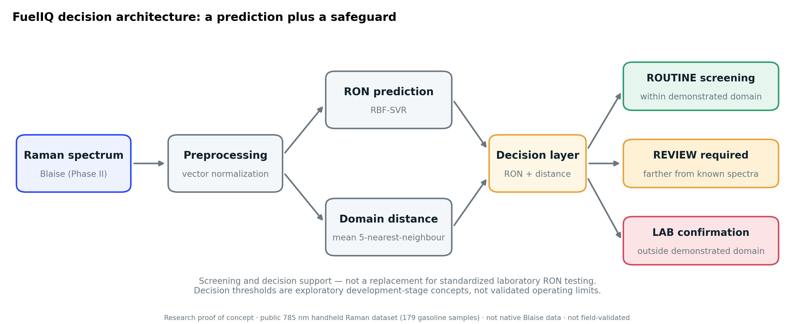
</p>

FuelIQ is designed around two outputs rather than one:

**A. Estimated RON**

A regression model processes the measured Raman spectrum and returns a numerical estimate.

**B. Applicability-domain assessment**

A separate check compares the sample's spectrum with reference spectra used during model development. A spectrum that is unusually distant from the reference population may indicate that the prediction is less reliable.

The app could combine these signals into three proposed user-facing states:

| Proposed status         | Intended interpretation                                                                                 | Suggested action                                      |
| ----------------------- | ------------------------------------------------------------------------------------------------------- | ----------------------------------------------------- |
| Routine screening       | Spectrum falls within a validated operating region and the model meets established performance criteria | Record the estimate as a preliminary screening result |
| Review required         | Spectrum or prediction raises a defined quality-control concern                                         | Review the sample, acquisition, and relevant context  |
| Laboratory confirmation | Sample is outside the validated domain or the decision requires authoritative testing                   | Refer for an appropriate laboratory method            |

These states are **proposed workflow concepts**, not currently validated operating thresholds or certified decision rules.

## 3. Research results

The initial FuelIQ study evaluated an RBF SVR regression baseline on a public gasoline Raman dataset. Preprocessing and hyperparameters were selected using development data and validation procedures before the final held-out test evaluation.

### Headline performance

| Metric                                    | Held-out test result |
| ----------------------------------------- | -------------------: |
| \(R^2\)                                   |               0.9655 |
| Mean absolute error (MAE)                 |           0.3343 RON |
| Root mean squared error (RMSE)            |           0.4330 RON |
| Mean prediction bias                      |          −0.0814 RON |
| Predictions within ±0.7 RON               |                83.3% |
| Bootstrap 95% confidence interval for MAE |      0.248–0.429 RON |

Development cross-validated MAE was 0.590 RON.

These are results from the available public dataset and its specified evaluation split. They are not estimates of performance on native Blaise hardware, across all commercial gasoline populations, or under field operating conditions.

### Dataset overview

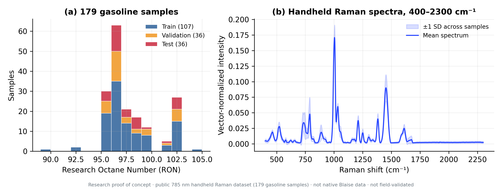

The research dataset contains 179 commercial gasoline samples and 1,901 Raman spectral variables spanning 400–2,300 cm⁻¹. The available data were divided into training, validation, and held-out test subsets for the reported modeling workflow.

### Example Raman spectra

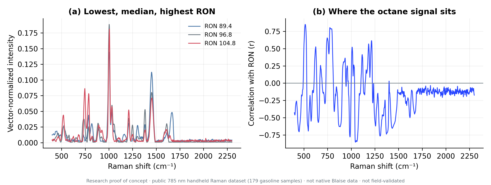

The spectral profiles provide the input features for regression. Before deployment, the acquisition and preprocessing workflow must be verified on spectra collected by the intended Blaise instrument.

### Preprocessing comparison

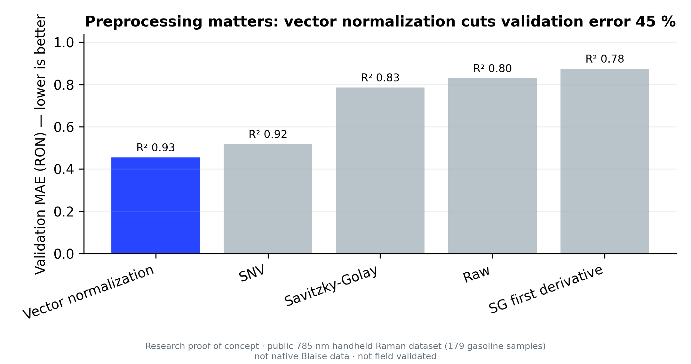

Preprocessing choices can materially affect model performance. FuelIQ records the evaluated alternatives so that the selected pipeline can be reproduced and compared against future device-specific baselines.

### SVR hyperparameter search

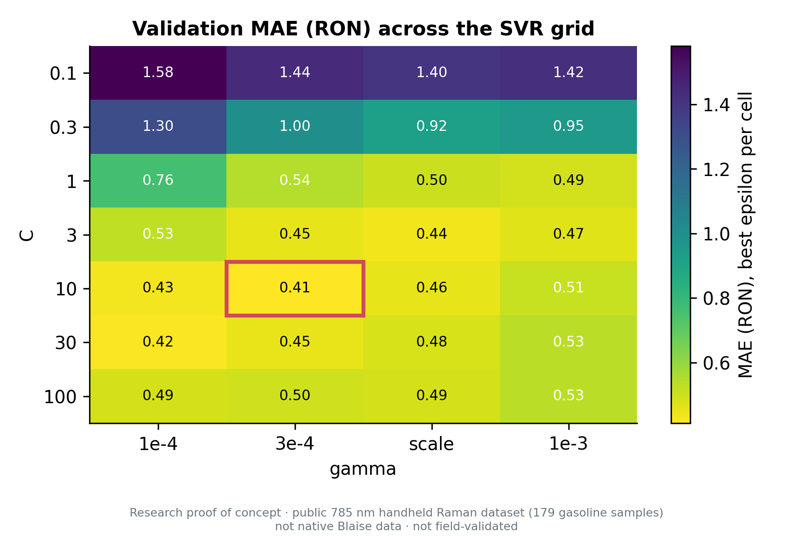

The hyperparameter search compares model configurations using development and validation data. The final test set is reserved for evaluating the frozen configuration rather than repeatedly selecting models.

### Held-out predictions

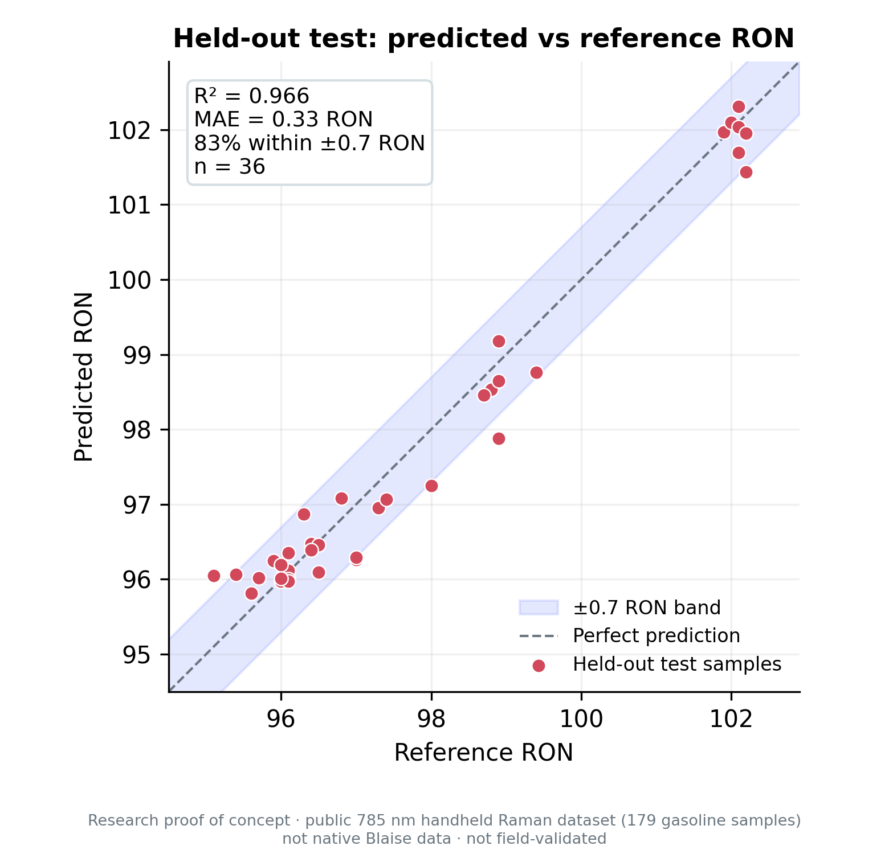

The predicted-versus-actual comparison illustrates how closely the frozen model's estimates track the laboratory reference values in the held-out research test set.

### Prediction residuals

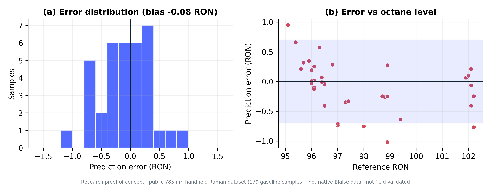

Residual analysis complements aggregate metrics by showing the direction and distribution of prediction errors. It is important to assess systematic bias and unusually large errors, not only average accuracy.

## 4. The trust check: applicability-domain assessment

A key FuelIQ design feature is its attempt to identify when a spectrum is less representative of the model's development data.

The research implementation uses nearest-neighbor spectral distance as an exploratory indicator of spectral familiarity.

In leakage-controlled five-fold cross-validation on 143 development samples:

* Spectral distance and absolute prediction error had a correlation of approximately \(r=0.48\).
* The farthest 10% of samples by distance had approximately 3.9 times the error of the closest half.
* The reported MAE was 1.52 RON in the farthest 10% group versus 0.39 RON in the closest half.

These results suggest that spectral distance may provide a useful warning signal. They do not establish that distance alone can reliably predict error for every sample.

### Distance versus prediction error

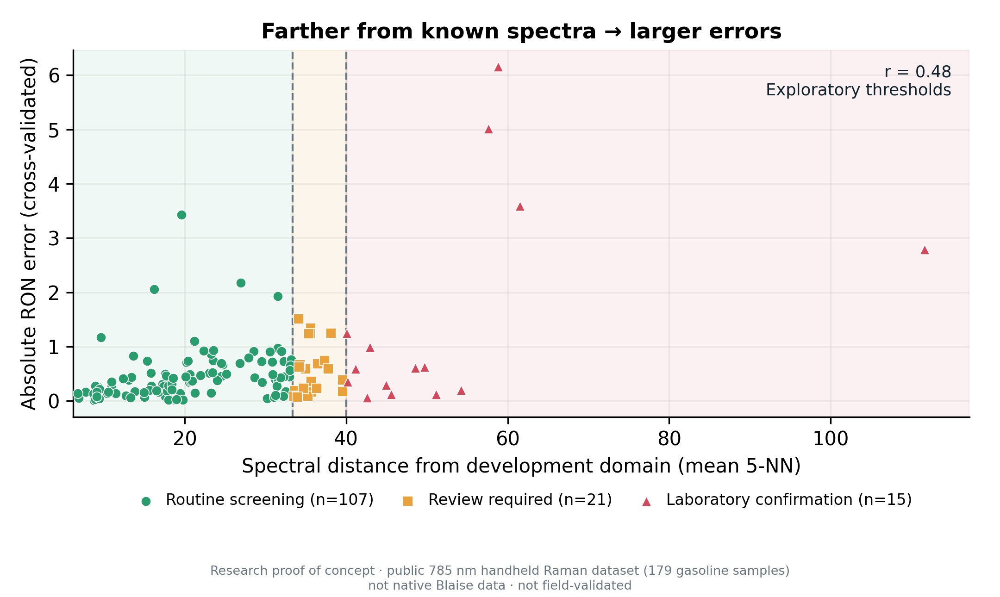

The plot examines the relationship between spectral distance and observed prediction error. This relationship should be reassessed on independent samples acquired with the intended device.

### Error by spectral-distance group

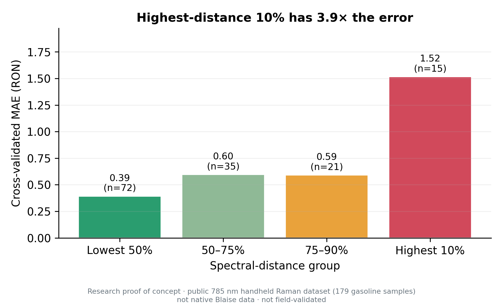

Grouping samples by distance helps illustrate whether less familiar spectra are associated with larger errors. Group boundaries and thresholds should be chosen using development data, then evaluated prospectively on independent data.

**Deployment principle:** A trust check must be validated independently of the model's headline regression accuracy. FuelIQ's current distance thresholds are exploratory and should not yet be treated as safety guarantees or definitive laboratory-referral criteria.

## 5. Blaise xTech Competition

FuelIQ is being developed as a concept for the Blaise xTech Competition, focused on mobile applications using the Blaise handheld Raman platform.

* **Official competition and submission portal:** [HeroX — xTech Idea Competition](https://www.herox.com/xTechIdeaCompetition?from=home)
* **Competition overview:** [Forward Edge-AI — Blaise xTech Competition](https://www.forwardedge.ai/pages/blaise-xtech-competition)
* **Phase I pitch template:** [Official template and instructions](https://support.forwardedge.ai/en/articles/10622895-blaise-xtech-competition-pitch-template)
* **Competition guidelines:** [Official guidelines](https://support.forwardedge.ai/en/articles/10622654-blaise-xtech-competition-guidelines)
* **FAQs:** [Official competition FAQs](https://support.forwardedge.ai/en/articles/10622846-blaise-xtech-competition-faqs)
* **Licensing:** [Official licensing agreement information](https://support.forwardedge.ai/en/articles/10622689-blaise-xtech-competition-licensing-agreement)

Consult the official portal for the current deadline, eligibility requirements, award terms, and submission instructions.

### Competition pathway

The competition has been described as a staged progression from an initial idea pitch toward working prototypes, testing, and final judging. The precise requirements and advancement rules should be checked against the current official guidelines.

| Stage                             | General objective                                                                                    |
| --------------------------------- | ---------------------------------------------------------------------------------------------------- |
| Phase I — Idea                    | Submit the required pitch materials and explain the problem, proposed solution, and potential impact |
| Phase II — Prototype              | Develop and demonstrate a working concept under the current program requirements                     |
| Phase III — Continued development | Advance selected teams through further development and evaluation                                    |
| Phase IV — Finalists              | Demonstrate and present finalist solutions for judging                                               |
| Phase V — People's Choice         | Participate in the program's designated public-choice or recognition stage, subject to current rules |

The published competition materials have described a Phase I package centered on a one-page pitch PDF and a video of no more than three minutes, with selected teams advancing to later stages. The official guidelines take precedence if requirements change.

### Pitch assets

**One-page pitch graphic**


**Video presentation graphic**

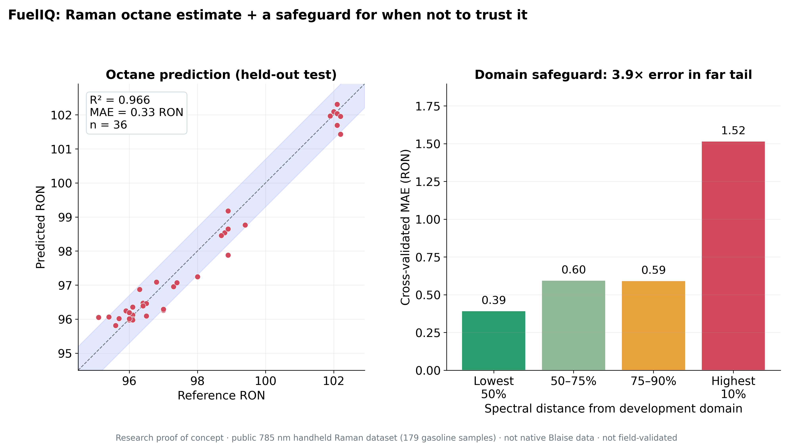

[Watch the FuelIQ pitch video](https://www.youtube.com/watch?v=6xwVU_PyTNk)

## 6. Development roadmap

The next step is not simply to optimize the current model further. It is to establish that the full acquisition-to-decision workflow works on the intended instrument.

### Milestone 1 — Collect native Blaise data

* Establish a repeatable sampling and acquisition protocol.
* Collect Raman spectra using the intended Blaise hardware.
* Pair each sample with an independent laboratory RON reference.
* Record sample handling, instrument settings, replicate measurements, and relevant metadata.
* Define data-quality and exclusion criteria before model evaluation.

**Deliverable:** A traceable native-device dataset with independent reference measurements.

### Milestone 2 — Build and validate the device-specific model

* Verify spectral compatibility and preprocessing.
* Establish simple baselines before evaluating more complex models.
* Separate samples and replicates appropriately to prevent data leakage.
* Freeze model selection before independent testing.
* Evaluate MAE, RMSE, bias, uncertainty, and error distributions.
* Validate the applicability-domain warning independently.

**Deliverable:** A reproducible, device-specific model evaluation.

### Milestone 3 — Develop the mobile workflow

* Create a guided sample-acquisition interface.
* Display the preliminary RON estimate with appropriate context.
* Present a clear screening or review status.
* Preserve sample identifiers, timestamps, and relevant quality-control information.
* Provide an explicit laboratory-confirmation pathway.
* Investigate device integration and deployment constraints with the appropriate SDK and licensing permissions.

**Deliverable:** A demonstrable mobile prototype connected to the intended acquisition workflow.

### Milestone 4 — Conduct a validation study

* Evaluate independent samples representative of intended users and operating conditions.
* Examine repeatability, robustness, instrument variation, and out-of-domain behavior.
* Establish decision thresholds from evidence rather than convenience.
* Document failure modes and limitations.
* Determine whether the system is suitable for a narrowly defined screening use case.

**Deliverable:** A documented validation report supporting the next deployment decision.

## 7. Intended users and potential impact

FuelIQ is intended to explore whether rapid preliminary screening could assist:

* Fuel distributors and terminal personnel.
* Fleet and depot quality teams.
* Fuel retailers and receiving operations.
* Inspectors and other personnel who need to prioritize samples for further investigation.

Potential benefits to investigate include faster preliminary screening, better prioritization of laboratory testing, more consistent sample records, and earlier identification of spectra that do not resemble the validated reference population.

These benefits remain hypotheses until demonstrated in an instrument-specific field study.

## 8. Commercial hypothesis

A possible future model is a software subscription for participating sites or fleets, with hardware, service, and consumables handled separately where appropriate and permitted by the relevant agreements.

For illustration only, a hypothetical subscription of $250 per month at 330 participating sites would correspond to:

$$
330 \times \$250 \times 12 = \$990{,}000
$$

in annual gross subscription revenue before costs.

This is an illustrative scenario—not a forecast, customer commitment, verified market size, or validated pricing strategy. Commercial planning requires customer discovery, hardware and operating-cost analysis, and confirmation of applicable licensing terms.

## 9. Research transparency and limitations

FuelIQ is a research prototype. The current findings support further investigation, not claims of certified measurement capability.

Key limitations include:

1. **Instrument transfer:** The public research spectra were not collected on the target Blaise handheld device.
2. **Dataset size:** The available dataset contains 179 samples; broader sample diversity is required to evaluate generalization.
3. **Independent validation:** The reported test metrics apply to the defined held-out research test set, not an independent field deployment.
4. **Applicability-domain calibration:** Spectral distance is an exploratory warning signal; thresholds require independent validation.
5. **Operational robustness:** Effects from sampling, temperature, acquisition settings, instrument variation, and sample handling must be studied.
6. **Reference quality:** Future training and evaluation depend on reliable, traceable laboratory RON measurements.
7. **Regulatory and commercial claims:** The current prototype is not presented as an accredited laboratory method or a certified fuel-quality determination system.

Future work should prioritize native-device data collection, rigorous leakage control, independent validation, reproducibility, and transparent reporting of failure cases.

## 10. Repository structure

```text
FuelIQ/
├── README.md
├── fueliq.ipynb
├── fueliq-revised.ipynb
├── figures/
│   ├── fig01_dataset_overview.png
│   ├── fig02_example_spectra.png
│   ├── fig03_preprocessing_comparison.png
│   ├── fig04_svr_grid_heatmap.png
│   ├── fig05_test_predicted_vs_actual.png
│   ├── fig06_test_residuals.png
│   ├── fig07_ad_distance_vs_error.png
│   ├── fig08_ad_error_by_group.png
│   ├── fig09_decision_architecture.png
│   ├── fig10_pitch_hero_onepage.png
│   └── fig11_pitch_hero_16x9_video.png
└── tables/
    ├── t01_dataset_summary.csv
    ├── t02_data_integrity_checks.csv
    ├── t03_baseline_validation.csv
    ├── t04_preprocessing_validation.csv
    ├── t05_svr_grid_top15.csv
    ├── t05b_svr_grid_full.csv
    ├── t06_frozen_model_config.csv
    ├── t07_final_test_metrics.csv
    ├── t08_final_test_predictions.csv
    ├── t09_test_metrics_bootstrap_ci.csv
    ├── t10_ad_error_by_distance_group.csv
    ├── t10b_cv_per_sample.csv
    ├── t11_ad_distance_thresholds.csv
    ├── t12_ad_decision_tiers.csv
    ├── t13_headline_numbers.csv
    ├── t14_report_reproducibility_check.csv
    └── t15_limitations_and_phase2.csv
```

## 11. Research tables and supporting data

The full CSV files are committed to the repository. Select a table to inspect its raw results on GitHub.

| Table                                                                            | Contents                                     |
| -------------------------------------------------------------------------------- | -------------------------------------------- |
| [T01 — Dataset summary](tables/t01_dataset_summary.csv)                          | Dataset composition and key characteristics  |
| [T02 — Data integrity checks](tables/t02_data_integrity_checks.csv)              | Data-quality and integrity audit             |
| [T03 — Baseline validation](tables/t03_baseline_validation.csv)                  | Baseline model comparisons                   |
| [T04 — Preprocessing validation](tables/t04_preprocessing_validation.csv)        | Preprocessing experiments                    |
| [T05 — Top 15 SVR configurations](tables/t05_svr_grid_top15.csv)                 | Best-performing configurations in the search |
| [T05b — Full SVR search](tables/t05b_svr_grid_full.csv)                          | Full hyperparameter search results           |
| [T06 — Frozen model configuration](tables/t06_frozen_model_config.csv)           | Selected model settings                      |
| [T07 — Final test metrics](tables/t07_final_test_metrics.csv)                    | Held-out performance metrics                 |
| [T08 — Final test predictions](tables/t08_final_test_predictions.csv)            | Per-sample test predictions                  |
| [T09 — Bootstrap confidence intervals](tables/t09_test_metrics_bootstrap_ci.csv) | Uncertainty estimates for test metrics       |
| [T10 — Error by distance group](tables/t10_ad_error_by_distance_group.csv)       | Applicability-domain group analysis          |
| [T10b — Cross-validation per sample](tables/t10b_cv_per_sample.csv)              | Per-sample cross-validation records          |
| [T11 — Distance thresholds](tables/t11_ad_distance_thresholds.csv)               | Exploratory distance thresholds              |
| [T12 — Decision tiers](tables/t12_ad_decision_tiers.csv)                         | Proposed screening and review tiers          |
| [T13 — Headline numbers](tables/t13_headline_numbers.csv)                        | Key project results                          |
| [T14 — Reproducibility check](tables/t14_report_reproducibility_check.csv)       | Report and reproducibility checks            |
| [T15 — Limitations and Phase II](tables/t15_limitations_and_phase2.csv)          | Limitations and proposed next steps          |

The notebook is the primary research workflow; the committed tables and figures are supporting artifacts. Rerunning a notebook does not automatically update the GitHub files: regenerated artifacts must be saved and committed to the repository.

## 12. Reproducibility

The repository contains two notebooks:

* [`fueliq-revised.ipynb`](fueliq-revised.ipynb) — revised research workflow.
* [`fueliq.ipynb`](fueliq.ipynb) — original research notebook.

For reproducible evaluation:

1. Review the notebook's dataset source and expected file structure.
2. Confirm package versions and preprocessing steps.
3. Execute the notebook from the intended starting point.
4. Check the saved metrics and figures against the committed artifacts.
5. Preserve the final test set for evaluation of the selected frozen model.
6. Document any changes that cause the reported results to differ.

Exact reproduction may depend on the availability of the source dataset and the notebook's execution environment.

## 13. Project and submission links

* **GitHub repository:** [ut1776/FuelIQ](https://github.com/ut1776/FuelIQ)
* **Revised notebook:** [fueliq-revised.ipynb](fueliq-revised.ipynb)
* **Original notebook:** [fueliq.ipynb](fueliq.ipynb)
* **Pitch video:** [Watch on YouTube](https://www.youtube.com/watch?v=6xwVU_PyTNk)
* **Blaise xTech competition:** [Official HeroX portal](https://www.herox.com/xTechIdeaCompetition?from=home)
* **Competition information:** [Forward Edge-AI](https://www.forwardedge.ai/pages/blaise-xtech-competition)

## Acknowledgement

FuelIQ is a proposed application of Raman spectroscopy and machine learning to preliminary gasoline octane screening. Its objective is to combine a useful numerical estimate with a transparent warning mechanism that helps users recognize the limits of a model's experience.

The research baseline is an initial step. Demonstrating compatibility with the Blaise handheld device, collecting representative paired Raman and laboratory data, and validating the complete workflow independently are the essential next steps.

---

<p align="center">
  <strong>FuelIQ — Estimate the octane. Check the evidence. Know when to confirm.</strong>
</p>

*Research prototype. Estimates are preliminary and are not a substitute for an appropriate laboratory test or certified fuel-quality determination.*
